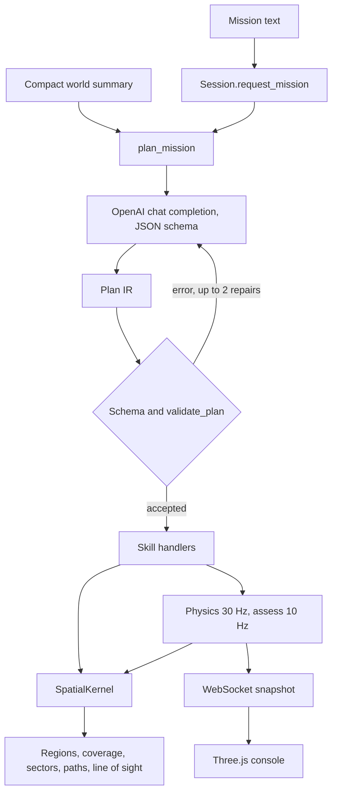

# Agent Armada

[](https://github.com/theorem-stack/Agent-Armada-community/actions/workflows/ci.yml)

One operator types a mission. A language model compiles it into a checked plan, and a geometry kernel flies a simulated drone swarm through that plan in a 3D scene.

Second place, LabLabAI Reasoning with o1 international hackathon, October 2024.

The console title and the npm package name are Agent Armada. The public repository is [`theorem-stack/Agent-Armada-community`](https://github.com/theorem-stack/Agent-Armada-community).

This is a simulated command post on a fixed 800×600 map, with no link to aircraft hardware.

## Why this is interesting

The hard part is turning a sentence into motion the simulator can check.

- **A closed plan language.** The model may only emit skills from a registry of seven actions, plus optional event rules. Places are symbols (`bbox_center`, a corner, an object name, or a type such as `person`). Raw coordinates fail schema validation.
- **Geometry stays in code.** Binding names, coverage, sector splits, lawnmower paths, standoff points, and line of sight all go through `SpatialKernel`. The prompt receives a short summary: agent count, the bounding box, known places, already detected contacts, undetected counts by type, and a scalar uncovered mass. The occupancy grid, the sector graph, and the names of unseen contacts stay in the kernel.
- **Check, then repair.** Every response is parsed as a Pydantic plan and run through `validate_plan` (unknown objects, hidden contact names, bad group ids, illegal shapes). The error text goes back to the model, up to two repairs (`PLAN_REPAIR_ATTEMPTS`). Only then does the session fly the plan.
- **The runtime scores the plan.** Arrival, coverage, a detection during the active search, and skill timeouts are computed in code. A detection requires the contact inside a downward cone and a clear ray past building, tree, and container boxes.

## Architecture



The browser creates a session, then posts the sentence to `POST /api/py/sessions/{id}/mission`. Planning is asynchronous: the HTTP call returns while the status is `planning`. The session keeps a physics loop at 30 Hz and an assess loop at 10 Hz. Assess marks detections, applies compiled `on_event` rules, may ask the planner to revise the same mission, and advances the task list. A WebSocket at `/ws/sessions/{id}` pushes the full snapshot on the assess clock. Next.js rewrites `/api/py/*` to the API in development. The socket is a separate URL (`NEXT_PUBLIC_WS_URL`, default `ws://127.0.0.1:8000`).

Validation also calls the kernel, so a plan that names an unknown object never starts. Repair lives inside `plan_mission`. If `apply_plan` still rejects the result, the session stores `plan_error` and returns to `idle`.

## Design decisions

**Seven skills.** `Allocate`, `GoTo`, `Form`, `Search`, `Hold`, `Investigate`, `Follow`. The registry builds both the system prompt and the JSON schema. Tasks are sequential. `on_event` is the only branch, and only when the compiled plan includes it. The when-values are `Detected`, `Lost`, `Moved`, and `Reacquired`.

**Search.** With no place, the kernel cuts the map into a 2×2 sector graph and assigns sectors from group or agent sites, then each site flies a lawnmower. A named place searches that region. `object_id` of `person` or `vehicle` means “cover the map until that type is seen.” Search ends when that type is detected during the task, or when coverage of the search area reaches 0.95 (`SEARCH_COVER_MIN`). A timeout fails it.

**Investigate and Follow.** The four nearest agents (`INVESTIGATE_COUNT`) take a standoff. The others stay on search paths. Follow keeps that standoff while the contact moves and stays active until the contact is lost or the operator aborts. People patrol inside the map. The kernel stores their velocity, and the physics loop rebinds Investigate and Follow setpoints each tick.

**What the model is allowed to know.** Landmarks of type building, flood, tree, and container start detected. People and vehicles start hidden. After a search is in the plan, naming a still-hidden person or vehicle is invalid; the plan must use the type or omit the id, and the runtime binds the contact when it is actually seen. Unmatched `person` or `flood` detections can trigger another compile of the original sentence. Matched event rules run without a model call.

**Motion.** Agents steer toward handler setpoints inside the box, with a small separation term. Alignment and cohesion weights in `api/config.py` are zero. An `avoid` overlay turns named objects into obstacles. `cruise_altitude` sets agent Z. The default cruise altitude is 50.

**The console.** `app/page.tsx` opens `hurricane_map` with 20 agents. The scene has a 2D map, a 3D orbit inspect view (sensor cones), and a first-person walk view (occluded contacts drawn as ghosts). The operator can submit or abort a mission and can place, move, and delete catalog objects or move the spawn. The plan panel and log follow the session snapshot.

The model name is `gpt-4o-mini` (`OPENAI_MODEL` in `api/config.py`), temperature 0.2, max 2000 tokens. Live compiles append a symbol-only record to `logs/compile.jsonl`. That directory is gitignored. Records tagged `model: "fake"` are not written there, which is how the tests stay offline.

## Tech stack

| Layer | What the repo uses |
| --- | --- |
| API | Python 3.10+, FastAPI 0.115, Uvicorn 0.30, Pydantic v2, NumPy |
| Planner | `openai` SDK, `python-dotenv`, model `gpt-4o-mini` |
| Tests | pytest, plus `httpx` for FastAPI’s `TestClient` |
| UI | Next.js 14, React 18, TypeScript and JavaScript, Tailwind CSS, Radix / shadcn-style components, Three.js |
| Node | 18.17 or newer (Next.js 14). Verified here on Node 22. |

`requirements.txt` pins `openai==3.37.0` and leaves `numpy`, `pytest`, and `httpx` unpinned. FastAPI pulls Pydantic. `api/requirements.txt` is a looser copy of that list, with the same `openai` pin; `npm run fastapi-dev` installs the root file.

## Getting started

From the repository root.

### Prerequisites

- Node.js 18.17+
- Python 3.10+ (3.12 verified). Several modules use `X | Y` unions at runtime.
- An OpenAI API key if you want a typed mission to compile. The map, the swarm, and the tests run without one. A missing key fails that mission with `Missing OPEN_AI_API_KEY`.

### Install

```bash
git clone https://github.com/theorem-stack/Agent-Armada-community.git
cd Agent-Armada-community
python3 -m venv .venv
source .venv/bin/activate
pip install -r requirements.txt
npm install
cp .env.example .env
```

Edit `.env` and set the variables below. Names only; placeholder values are in [`.env.example`](.env.example).

| Variable | Role |
| --- | --- |
| `OPEN_AI_API_KEY` | OpenAI key for `plan_mission` |
| `NEXT_PUBLIC_WS_URL` | Optional WebSocket base. Default `ws://127.0.0.1:8000` |

`.env` is gitignored. `.env.example` is not.

### Run

Keep the virtualenv active so `npm run dev` installs and launches the API with that interpreter. The script runs Next.js and Uvicorn together, and it reinstalls Python dependencies on every start.

```bash
source .venv/bin/activate
npm run dev
```

- Console: http://localhost:3000
- API: http://127.0.0.1:8000
- OpenAPI: http://127.0.0.1:8000/api/py/docs (also proxied at http://localhost:3000/docs in development)

Equivalent two-process form, from the repo root:

```bash
source .venv/bin/activate
python -m uvicorn api.index:app --reload --host 127.0.0.1 --port 8000
```

```bash
npm run next-dev
```

The UI hardcodes `hurricane_map`. On load it creates a session and subscribes to the socket. Type a mission in the left panel. Without a key, the session still runs and the mission ends in a planning error.

### Tests

From the repo root, with the virtualenv active. No API key and no server.

```bash
source .venv/bin/activate
python -m pytest
```

The suite is 128 tests under `api/tests/`. It covers geometry and the kernel, plan IR, validation and repair parsing, predicates, session loops, and golden plan JSON. `conftest.py` puts the repo root on `sys.path`.

`httpx` is listed in `requirements.txt` because Starlette’s `TestClient` imports it. `openai==3.37.0` depends on `httpx2` rather than the `httpx` module.

## Project structure

```
api/
  index.py            HTTP routes and the session WebSocket
  config.py           clocks, swarm size, sensor, model name
  geometry/           kernel, regions, coverage, sectors, line of sight, path generators
  plan/               IR, skill registry, validation, handlers, predicates
  planner/            OpenAI compile, world summary, compile log
  session/            world, in-memory sessions, physics and assess loops
  simulation/         agents, map objects, three authored maps
  tests/              pytest
app/                  Next.js console (scene, mission input, plan, log)
components/           shared panel and UI primitives
docs/spatial-kernel.md
```

`docs/spatial-kernel.md` is the design log for the kernel. Slices 1–21 are marked done. Later slices supersede earlier ones: the catalog is seven skills (Slice 16 adds Follow), and Search completion follows Slice 19 rather than the person-only rule in Slice 18.

`api/simulation/maps.py` also defines `national_park_map` and `small_town_map`. The console does not open them, and their types (`animal`, `water`, `road`, `open_land`) are outside `OBJECT_CATALOG`.

## Limitations

- Sessions live in one process (`SessionStore`). Nothing is persisted. CORS allows every origin, and the API has no authentication.
- The production rewrite in `next.config.js` sends `/api/py/*` to `/api/`. There is no deploy config in the repo. The steps above are for local development.
- The planner is one completion plus repairs. Kernel queries run in the validator and the skill handlers.
- Motion is kinematic steering in the plane, plus a fixed altitude. The 5×5 terrain grid in `api/config.py` is a debug field. Alignment and cohesion are weighted at zero.
- The WebSocket sends the whole snapshot at 10 Hz.
- A live compile against the installed SDK was not part of the test suite.

## History

The original Agent Armada was built by hand in one week in October 2024 for the Reasoning with o1 hackathon, where it placed second.
In October 2026 the code was cleaned up for public release and the documentation was rewritten.

## Author

Cameron Gifford — [theorem-stack](https://github.com/theorem-stack)

## License

[MIT](LICENSE). Copyright (c) 2024-2026 Cameron Gifford.
